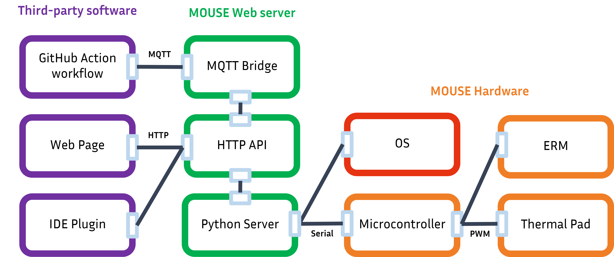

# MOUSE: Multimodal Output for Understanding Software Energy 

Creators : 
* Pierre-Antoine Cabaret - Rainbow Research Team, INSA Rennes, University of Rennes, IRISA
  * ATER at INSA Rennes, France 
  * personal website: https://pcabaret.github.io/
* Quentin Perez - DiverSE Research Team, INSA Rennes, University of Rennes, IRISA
  * Associate Professor at INSA Rennes, France
  * personal website: https://qperez.github.io/ 

## What is MOUSE?

MOUSE (*Multimodal Output for Understanding Software Energy*) is a computer mouse that provides multimodal feedback about software energy consumption. It can provide combination of haptic feedback (vibration, heat) and pseudo-haptic feedback (altered mouse speed).

The prototype of MOUSE was built using off-the-shelf components (see [BOM](#hardware)): it is based on an M5Stack Core microcontroller that uses PWM control to drive an ERM (Eccentric Rotating Mass) vibration motor and a thermal heating pad.

The software component consists of both a Python server and microcontroller firmware written in C and deployed on an M5Stack Core One.

More information can be found in the [Software Arhitecture section](#software-architecture).

## Hardware 

### Bills Of Materials
* 1x, Wireless Mouse Components Kit, 13€, [Bambulab store](https://eu.store.bambulab.com/products/wireless-mouse-components-kit-002) 
* 1x, M5Stack Core One, 43.13€, [RS Online](https://fr.rs-online.com/web/p/accessoires-pour-outils-de-developpement/0314175)
* 1x Power MOSFET IRF540N (5 pieces), 1.70€, [OpenCircuit](https://opencircuit.shop/product/irf540n-power-mosfet-5-pcs)
* 1x 10k ohm Resistors (10 pieces), 1.65€, [OpenCircuit](https://opencircuit.shop/product/10k%CF%89-metal-film-resitor-1-4w-10-pieces)
* 2x Diode Rectifier 1N4001, 0.25€, [OpenCircuit](https://opencircuit.shop/product/diode-rectifier-1a-50v-1n4001)
* 1x Heating Pad, [OpenCircuit](https://opencircuit.shop/product/heating-pad-5x10cm)
* 1x M5 Proto Module, 4.76€, [RS Online](https://fr.rs-online.com/web/p/accessoires-pour-outils-de-developpement/2027602)
* 1x Male Pins, 2.79€, [Conrad](https://www.conrad.fr/fr/p/barrette-male-standard-te-connectivity-ampmodu-mod-ii-826629-8-nbr-de-rangees-1-nombre-de-poles-par-rangee-8-1-pc-s-1094760.html)
* 1x USB A power Cable, 2.49€, [Bambulab store](https://eu.store.bambulab.com/products/usb-a-power-cable-with-ph2-0-connector)
* 1x 1kg PLA spool, 18.79€, Amazon

### 3D Models

* Mouse shell: https://store.bblcdn.eu/s8/default/680ed2ecb3624801b80e00a56af25af7/3D_model_for_Wireless_Mouse_Kit-002.zip
* Mouse model (ergo mouse Snake model): https://makerworld.com/en/models/479899?from=search#profileId-391349

### Hardware Building

Section in progress...

## Software Architecture




## Project structure

The repository contains the main software components, three demos, API documentation, and visual assets:

```
.
├── IDE_LSP_plugin/            # Java LSP plugin (Maven)
├── C_code_M5Stack_core_one/   # M5Stack firmware (PlatformIO)
├── mouse_server_serial_hub/   # Python Flask server
├── demo/
│   ├── java_complexity_demo/  # Java cyclomatic complexity example
│   ├── web_graphic_user_interface/ # Browser control interface
│   └── github_action_example/ # GitHub Actions MQTT example
├── http_api_documentation/    # REST API documentation (OpenAPI 3.0)
├── figures/                   # Visual assets
└── README.md
```

### IDE LSP Plugin (`IDE_LSP_plugin/`)

A Java LSP (Language Server Protocol) plugin built with Maven. It computes the cyclomatic complexity of each method in real time using `CyclomaticComplexityAnalyzer`, then forwards the metrics to the Flask server via `POST /metric/complexity`.

### M5Stack firmware (`C_code_M5Stack_core_one/`)

A C/C++ firmware project built with PlatformIO for the M5Stack Core One. It receives JSON commands from the Flask server over serial, updates the LVGL display with CPU and complexity information, and controls the vibration motor and heating pad using PWM.

### Flask server (`mouse_server_serial_hub/`)

The central piece. It exposes the REST API and coordinates the other components:

| Sub-folder | Role |
|---|---|
| `controllers/` | Flask Blueprints for serial setup, mouse control, vibration, thermal feedback, and complexity metrics |
| `services/` | CPU and complexity reporting, mouse-speed control, and MQTT command handling |
| `shared/` | Shared mouse and M5 state, haptic service, complexity data, and feedback profiles |
| `serial_mouse/` | Serial connection and Windows/X11 mouse drivers |

### Demos

#### Java complexity demo (`demo/java_complexity_demo/`)

Contains a Java example with methods of varying cyclomatic complexity, used to demonstrate analysis by the IDE LSP plugin.

#### Web interface (`demo/web_graphic_user_interface/`)

The `mouse_page.html` page lets users configure the serial port, control mouse speed and haptic feedback, and monitor CPU and device status. It communicates with the Flask server using its REST API and Socket.IO.

#### GitHub Actions example (`demo/github_action_example/`)

The example workflow measures CPU load and publishes a feedback command to the MQTT broker. The Flask server's MQTT bridge receives the command and forwards the requested feedback to the mouse or M5Stack.

### API documentation (`http_api_documentation/`)

The **OpenAPI 3.0** specification documents the Flask REST API for serial-port configuration, mouse control, thermal and vibration feedback, and cyclomatic-complexity metrics. Live CPU and serial connection status is reported separately through Socket.IO.